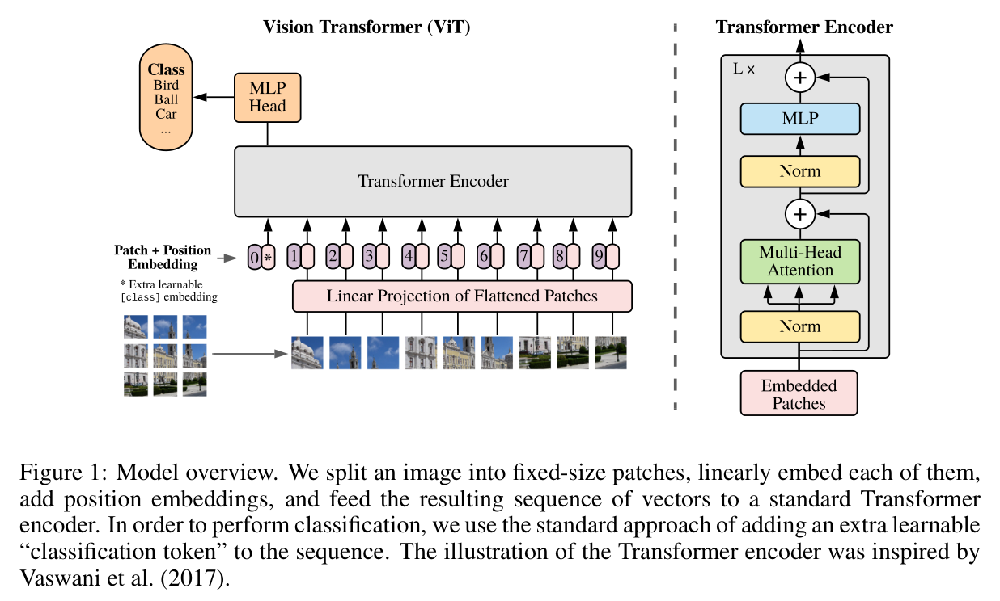
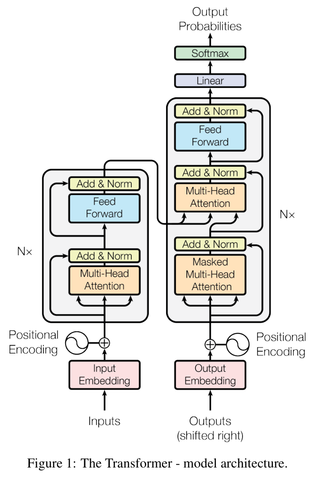

# Amazing Figures & Tables 🎨

论文图表收藏夹 —— 收集我认为好看的图和表，学习它们的设计语言。

## 目录结构

```
figures/
├── paradigm/     # 范式图：讲清一类方法的整体思路/对比
├── model/        # 模型图：单个模型/网络的架构
└── mechanism/    # 机制图：某个具体模块/原理如何工作
tables/
├── comparison/   # 对比实验表：与 SOTA 比较的主表
└── ablation/     # 消融实验表：拆解各组件贡献
```

---

## 🖼 图

### 范式图 (paradigm)

#### Vision Transformer — 模型总览


- **论文**：*An Image is Worth 16x16 Words: Transformers for Image Recognition at Scale*（ICLR 2021）
- **作者**：Dosovitskiy et al.
- **链接**：[arXiv:2010.11929](https://arxiv.org/abs/2010.11929)
- **好看在哪**：左侧一张真实图片按 patch 切块、线性映射成序列的「直觉展示」+ 右侧 encoder 堆叠细节，一图讲清「图像→序列」的范式转换；左大右小的信息密度分层值得学。

### 模型图 (model)

#### Transformer — 经典架构图


- **论文**：*Attention Is All You Need*（NeurIPS 2017）
- **作者**：Vaswani et al.
- **链接**：[arXiv:1706.03762](https://arxiv.org/abs/1706.03762)
- **好看在哪**：计算机视觉史上被复刻最多的架构图。编码器/解码器左右对称，数据自下而上流动，彩色模块 + 细线残差分支，信息层级一眼分明。

### 机制图 (mechanism)

*（暂无收藏）*

---

## 📊 表

### 对比实验表 (comparison)

*（暂无收藏）*

### 消融实验表 (ablation)

*（暂无收藏）*

---

## 📝 如何添加新条目

1. **截图/裁图**：从论文 PDF 裁出图或表（含题注），存成 PNG
2. **命名**：`第一作者-年份-关键词.png`，如 `he-2016-resnet-architecture.png`
3. **归位**：按类型放进对应目录（图 → `figures/{paradigm|model|mechanism}/`，表 → `tables/{comparison|ablation}/`）
4. **登记**：在 README 对应分类下按模板加一段：

```markdown
#### 简短标题


- **论文**：*论文标题*（会议 年份）
- **作者**：第一作者 et al.
- **链接**：[arXiv:xxxx.xxxxx](https://arxiv.org/abs/xxxx.xxxxx)
- **好看在哪**：一句话记录你欣赏它的设计点
```

5. **提交**：`git add -A && git commit -m "add: 关键词" && git push`
