# Amazing Figures & Tables 🎨

论文图表收藏夹 —— 收集我认为好看的图和表。

## 目录结构

```
figures/
├── paradigm/     # 范式图
├── model/        # 模型图
├── motivation/   # 动机图
└── results/      # 结果图
tables/
├── comparison/   # 对比实验表
└── ablation/     # 消融实验表
```

---

## 🖼 图

### 范式图 (paradigm)

#### PathNavigate 范式对比图

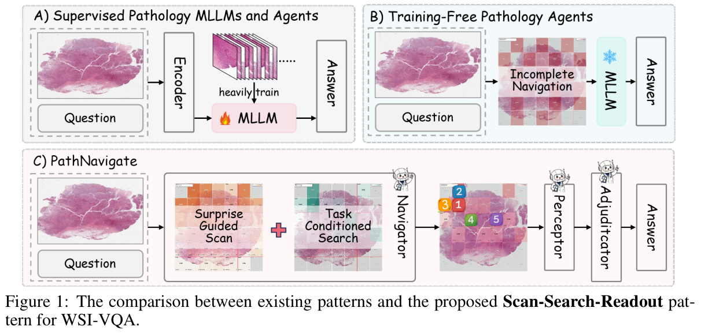

- **论文**：*PathNavigate: A Training-Free Pathology Agent with Surprise-Guided Scan and Shared Slide Memory for Whole-Slide Image VQA*（arXiv 2026）
- **链接**：[arXiv:2605.23559](https://arxiv.org/abs/2605.23559)

#### 医学 VQA 视觉定位范式对比图

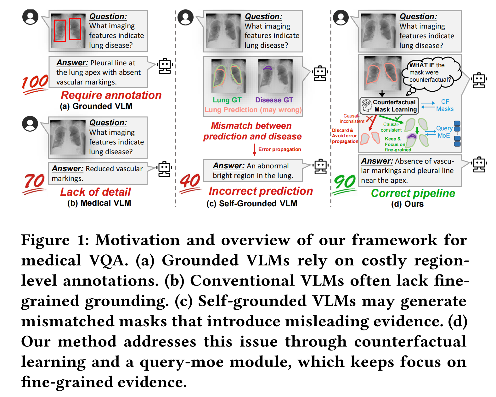

- **论文**：未知（Counterfactual Mask Learning + Query MoE 医学 VQA，四范式对比动机图）
- **链接**：待补充

### 模型图 (model)

#### WSI-Agents 总览图

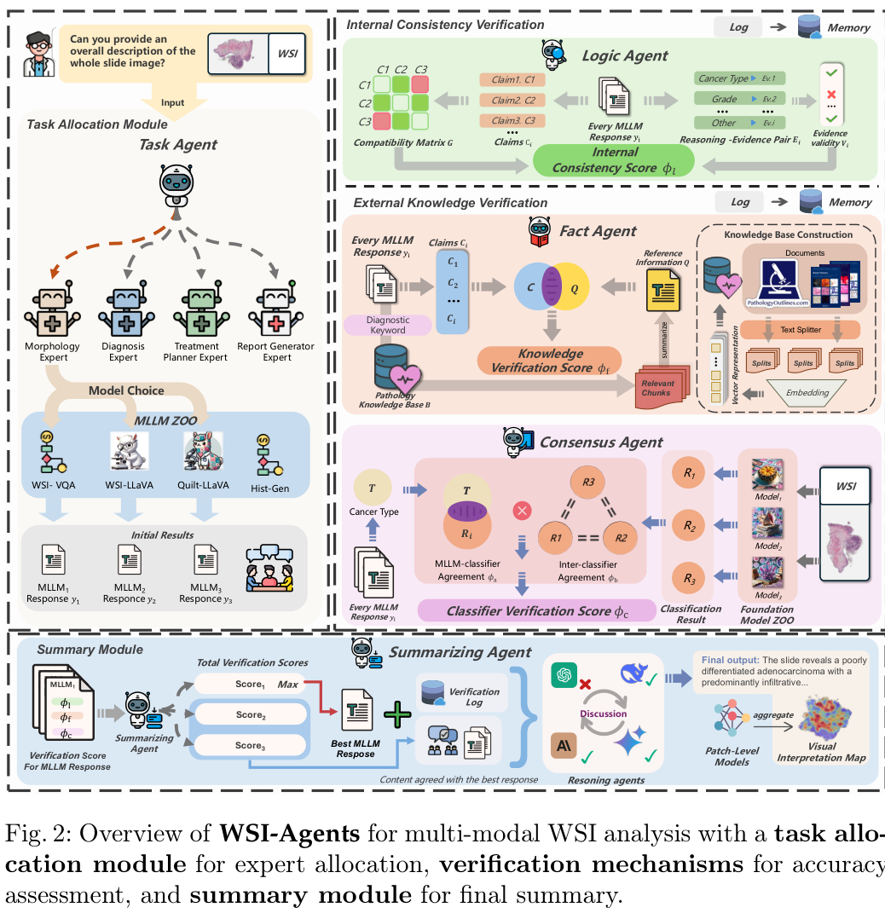

- **论文**：*WSI-Agents: A Collaborative Multi-Agent System for Multi-Modal Whole Slide Image Analysis*（arXiv 2025）
- **链接**：[arXiv:2507.14680](https://arxiv.org/abs/2507.14680)

#### PathGen 多智能体协作流水线图

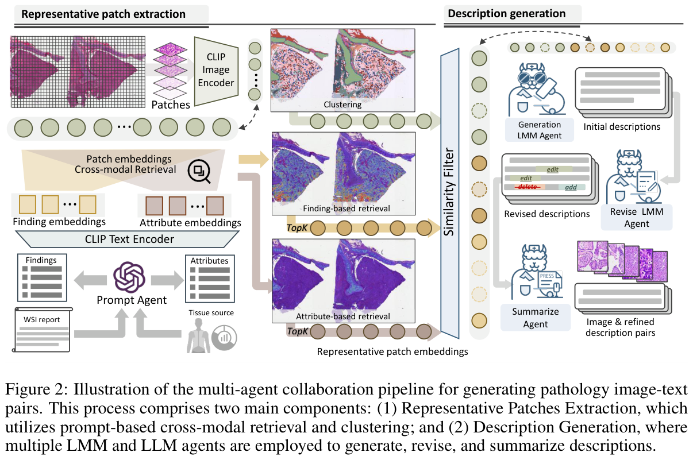

- **论文**：*PathGen-1.6M: 1.6 Million Pathology Image-text Pairs Generation through Multi-agent Collaboration*（ICLR 2025）
- **链接**：[arXiv:2407.00203](https://arxiv.org/abs/2407.00203)

#### DFQ+ 框架图

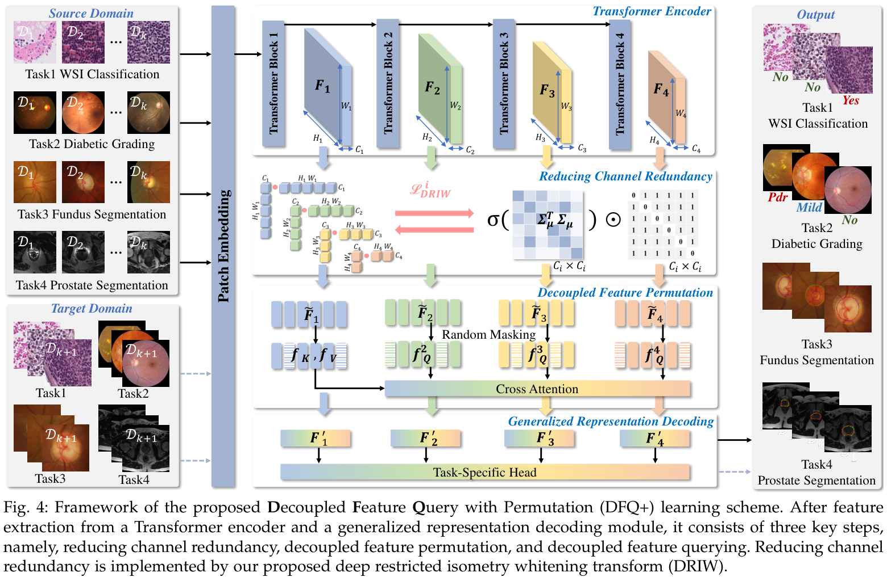

- **论文**：*Learning Generalized Medical Image Representation by Decoupled Feature Queries*（TPAMI 2025）
- **链接**：[IEEE 11122336](https://ieeexplore.ieee.org/document/11122336)

#### PRPL 方法总览图

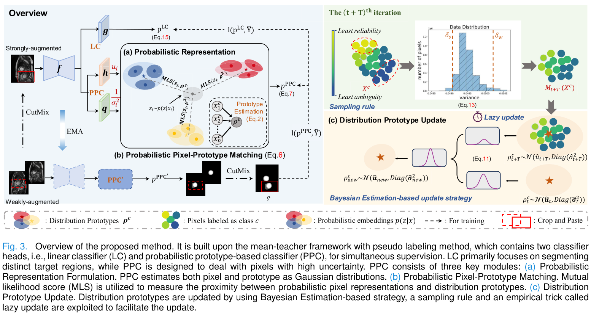

- **论文**：*Effective Semi-Supervised Medical Image Segmentation With Probabilistic Representations and Prototype Learning*（TMI 2025）
- **链接**：[DOI 10.1109/TMI.2024.3484166](https://doi.org/10.1109/TMI.2024.3484166)

#### PathNavigate 总览图

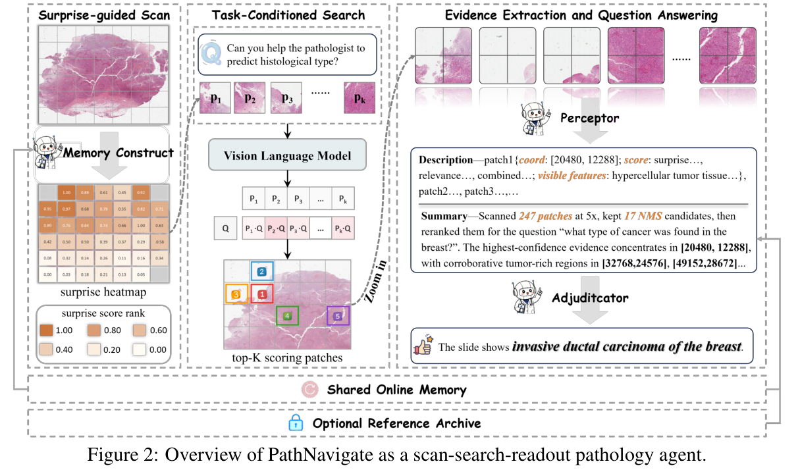

- **论文**：*PathNavigate: A Training-Free Pathology Agent with Surprise-Guided Scan and Shared Slide Memory for Whole-Slide Image VQA*（arXiv 2026）
- **链接**：[arXiv:2605.23559](https://arxiv.org/abs/2605.23559)

#### UTCS 模型架构图

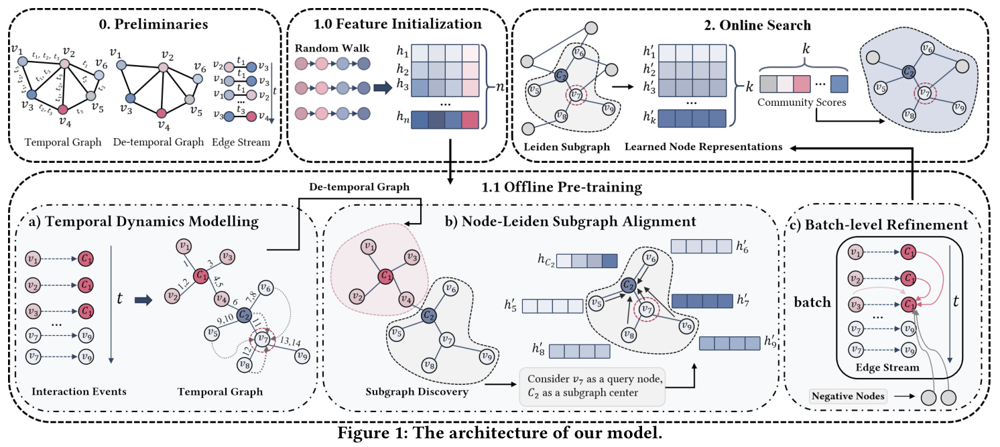

- **论文**：*UTCS: Effective Unsupervised Temporal Community Search with Pre-training of Temporal Dynamics and Subgraph Knowledge*（arXiv 2025）
- **链接**：[arXiv:2506.02784](https://arxiv.org/abs/2506.02784)

#### 扩散超分双引导框架图（来源未知）

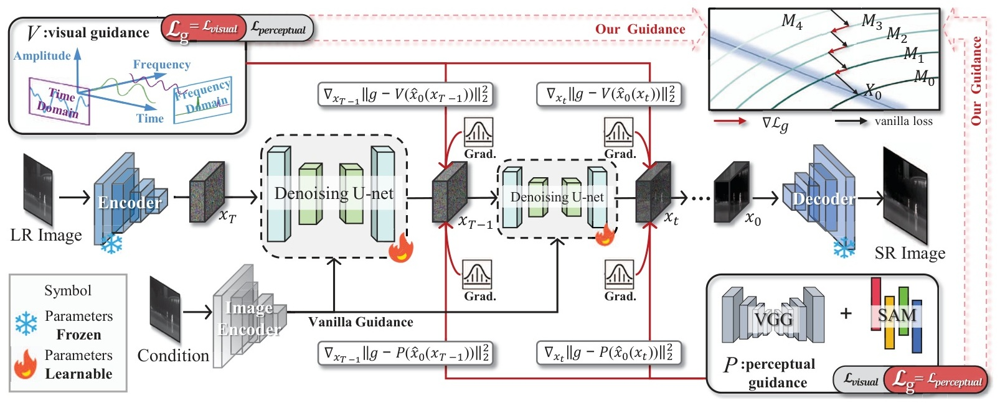

#### BrainGPT 总览图

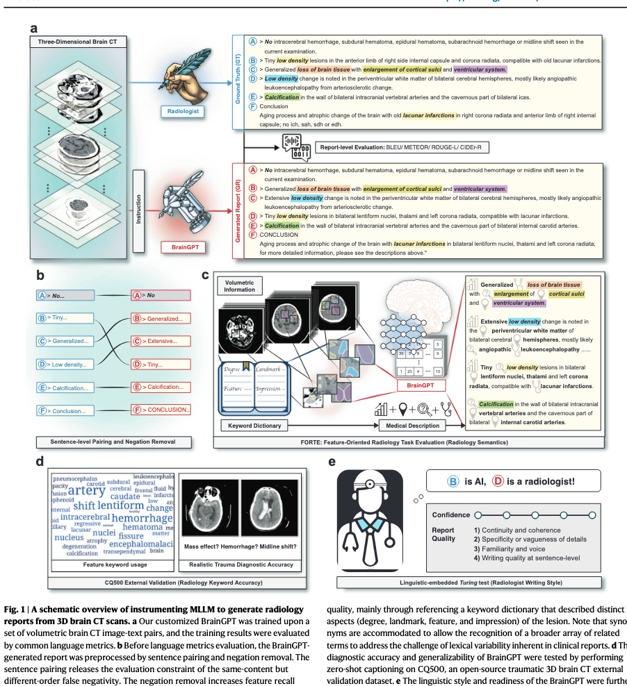

- **论文**：*Towards a Holistic Framework for Multimodal Large Language Models in Three-dimensional Brain CT Report Generation*（Nature Communications 2025）
- **链接**：[arXiv:2407.02235](https://arxiv.org/abs/2407.02235)

#### BrainGFM 总览图

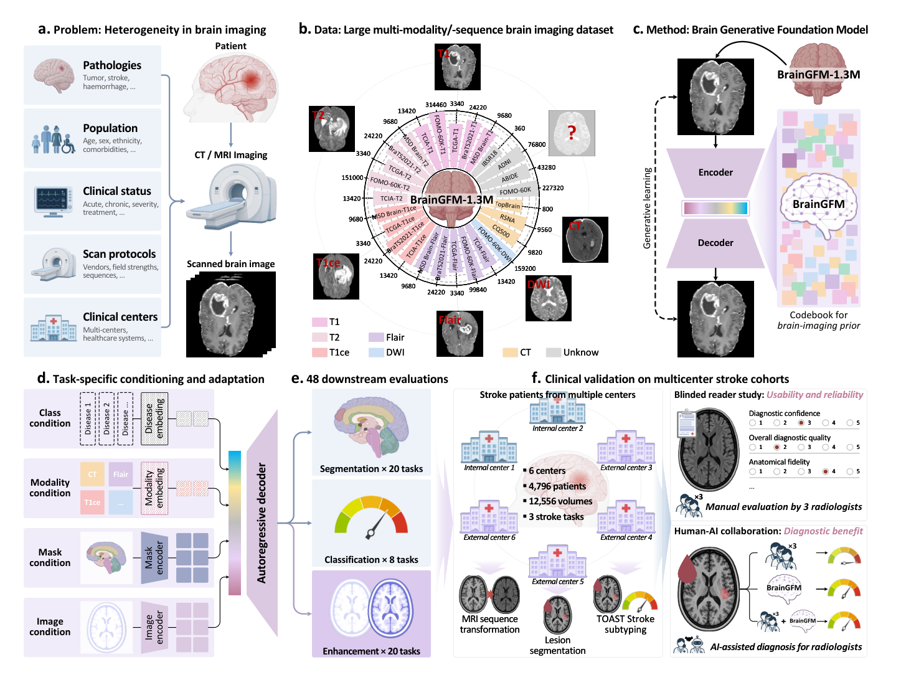

- **论文**：*A generative foundation model for computational brain imaging*（arXiv 2026）
- **链接**：[arXiv:2611.00265](https://arxiv.org/abs/2611.00265)
- **说明**：问题→数据→方法→应用→评测→验证六面板叙事总览，1.3M 切片预训练 + 48 下游任务 + 6 中心 4,796 例卒中临床验证

#### BrainGFM 架构图

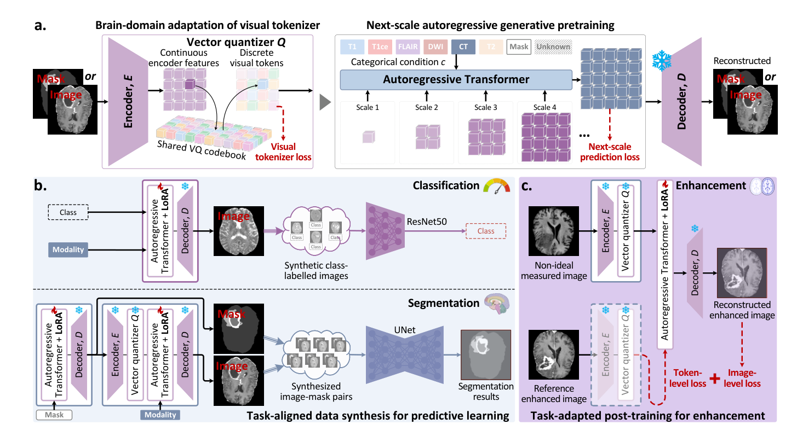

- **论文**：*A generative foundation model for computational brain imaging*（arXiv 2026）
- **链接**：[arXiv:2611.00265](https://arxiv.org/abs/2611.00265)
- **说明**：VQ 视觉 tokenizer 脑域适配 + next-scale 自回归生成预训练 + LoRA 下游适配（数据合成 / 图像增强）

### 动机图 (motivation)

#### PRPL 动机图

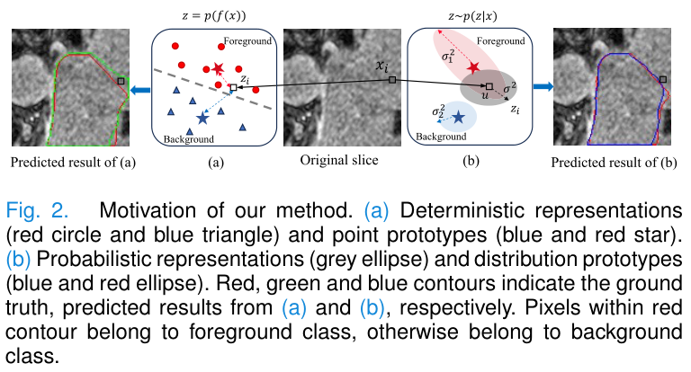

- **论文**：*Effective Semi-Supervised Medical Image Segmentation With Probabilistic Representations and Prototype Learning*（TMI 2025）
- **链接**：[DOI 10.1109/TMI.2024.3484166](https://doi.org/10.1109/TMI.2024.3484166)

#### AD 原型对比与形态测量总览图（来源未知）

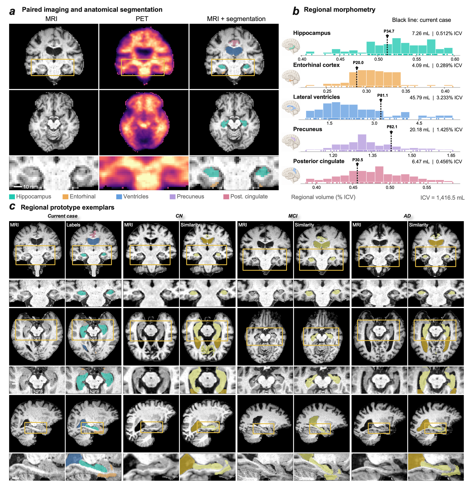

### 结果图 (results)

#### PAM 定量分析图

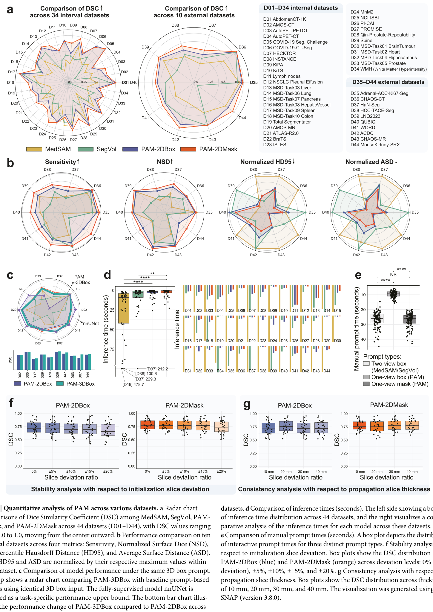

- **论文**：*PAM: a propagation-based model for segmenting any 3D objects across multi-modal medical images*（npj Digital Medicine 2025）
- **链接**：[DOI 10.1038/s41746-025-02087-y](https://doi.org/10.1038/s41746-025-02087-y)

#### BrainGFM 任务对齐数据合成结果图

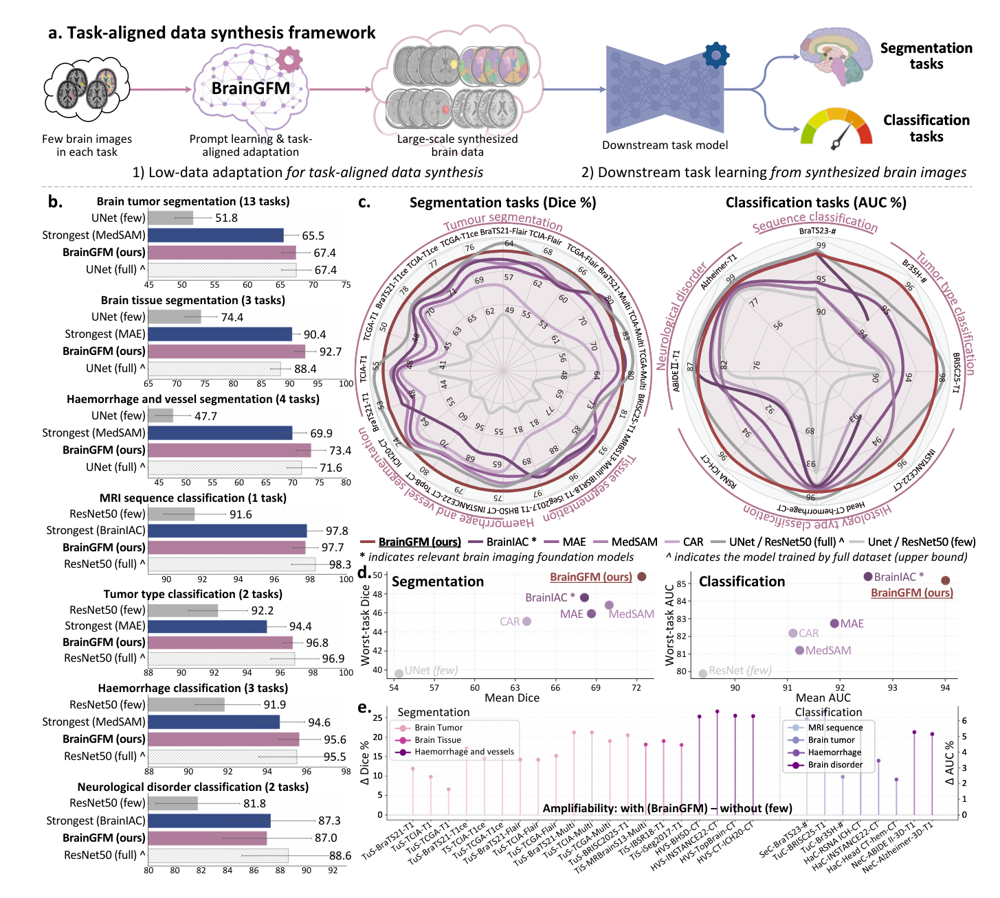

- **论文**：*A generative foundation model for computational brain imaging*（arXiv 2026）
- **链接**：[arXiv:2611.00265](https://arxiv.org/abs/2611.00265)
- **说明**：28 个预测任务的少样本 vs 全监督对比，雷达图 + mean-worst 散点 + 逐数据集增益棒棒糖图

#### BrainGFM 图像增强结果图

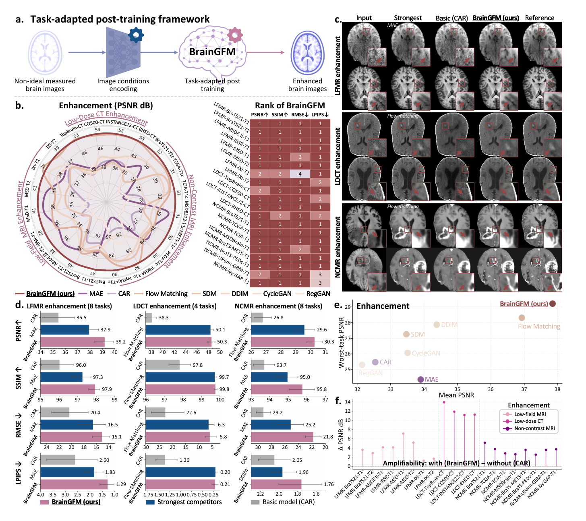

- **论文**：*A generative foundation model for computational brain imaging*（arXiv 2026）
- **链接**：[arXiv:2611.00265](https://arxiv.org/abs/2611.00265)
- **说明**：20 个增强任务（低场 MRI / 低剂量 CT / 无对比剂 MRI），PSNR 雷达图 + 排名热力表 + 定性对比 + 增益分解

#### BrainGFM 盲法读者研究与人机协作结果图

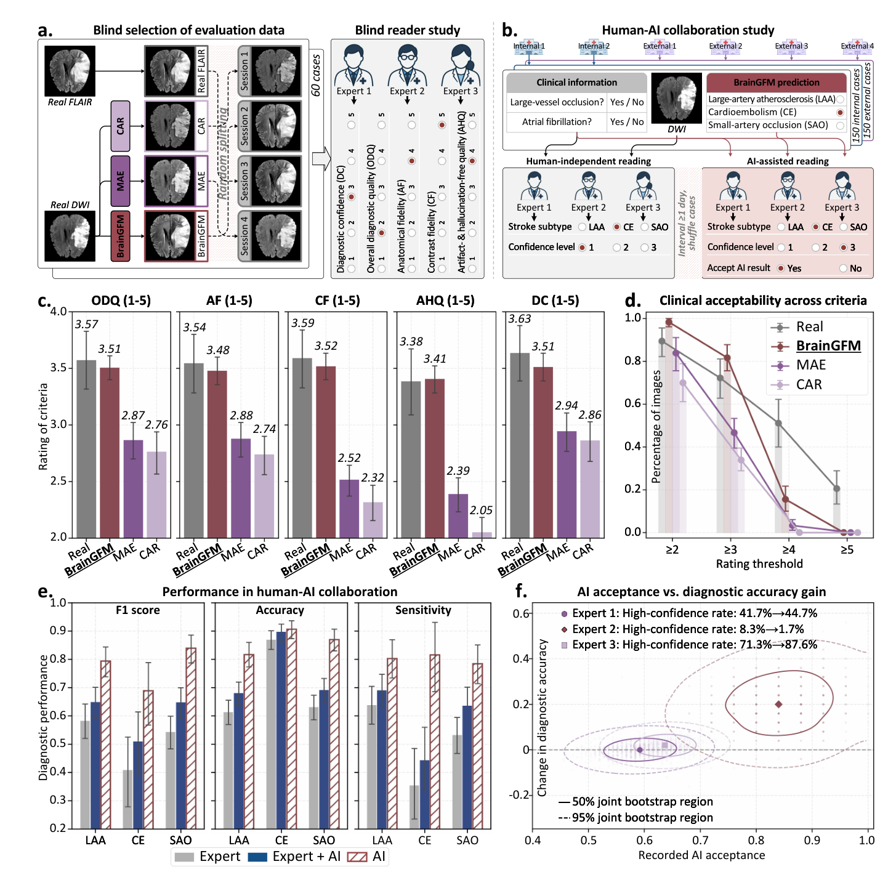

- **论文**：*A generative foundation model for computational brain imaging*（arXiv 2026）
- **链接**：[arXiv:2611.00265](https://arxiv.org/abs/2611.00265)
- **说明**：合成 FLAIR vs 真实图像的五维盲评（BrainGFM≈真实），人机协作使放射科医生卒中分型准确率相对提升 14%

#### BrainGFM 消融与分析图

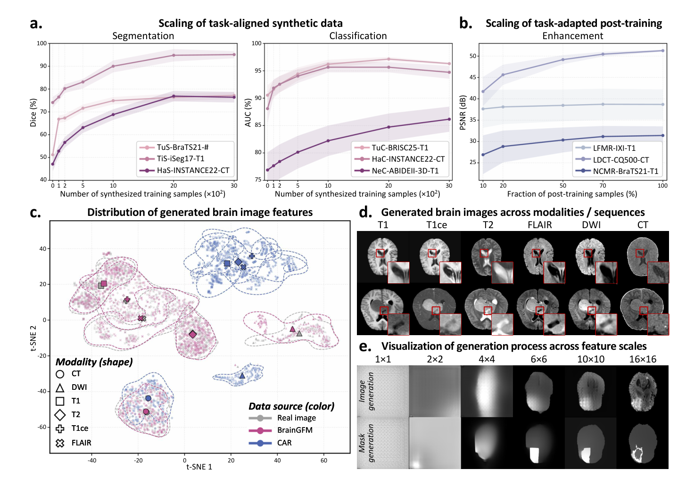

- **论文**：*A generative foundation model for computational brain imaging*（arXiv 2026）
- **链接**：[arXiv:2611.00265](https://arxiv.org/abs/2611.00265)
- **说明**：合成数据 / 后训练数据 scaling 曲线，特征分布 t-SNE，跨模态生成样例与多尺度生成过程可视化

---

## 📊 表

### 对比实验表 (comparison)

*（暂无收藏）*

### 消融实验表 (ablation)

*（暂无收藏）*
