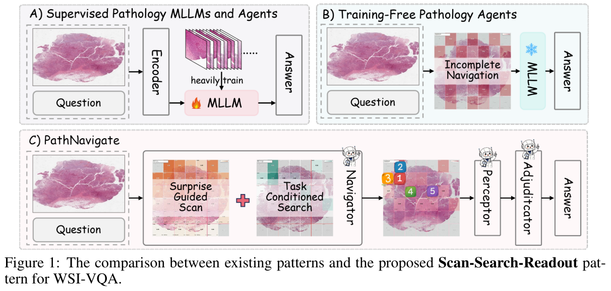
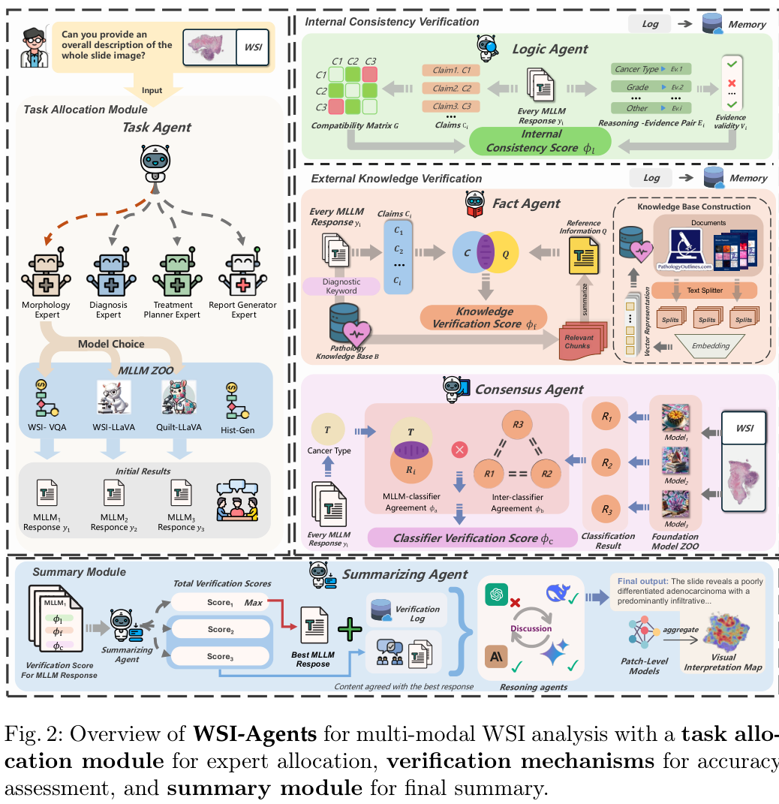
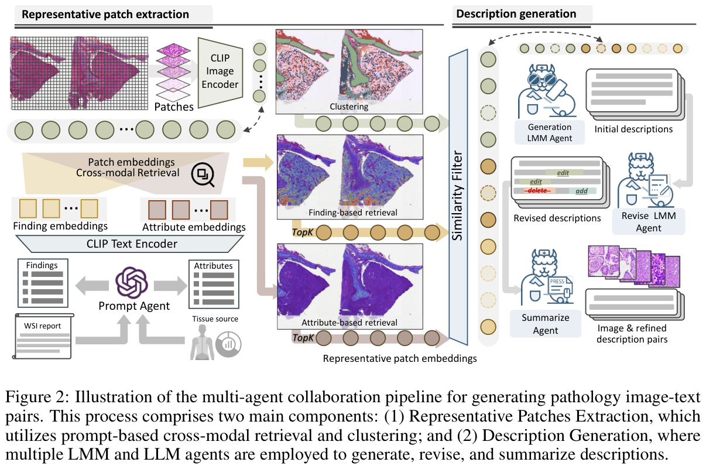
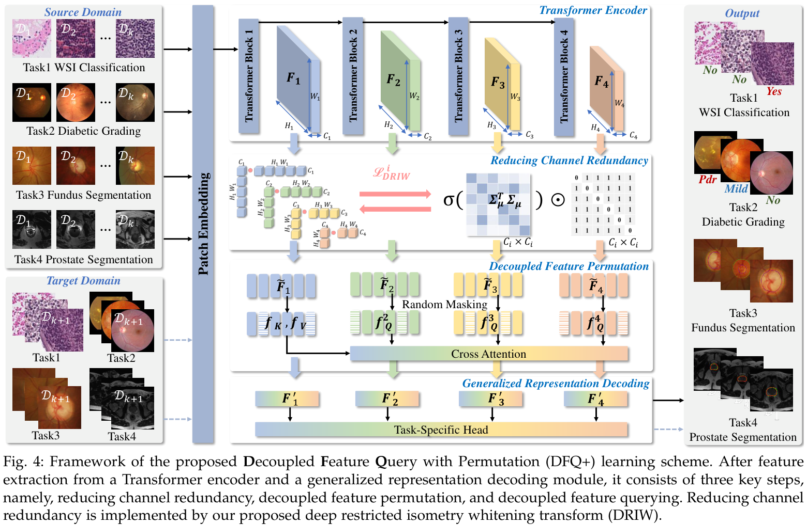
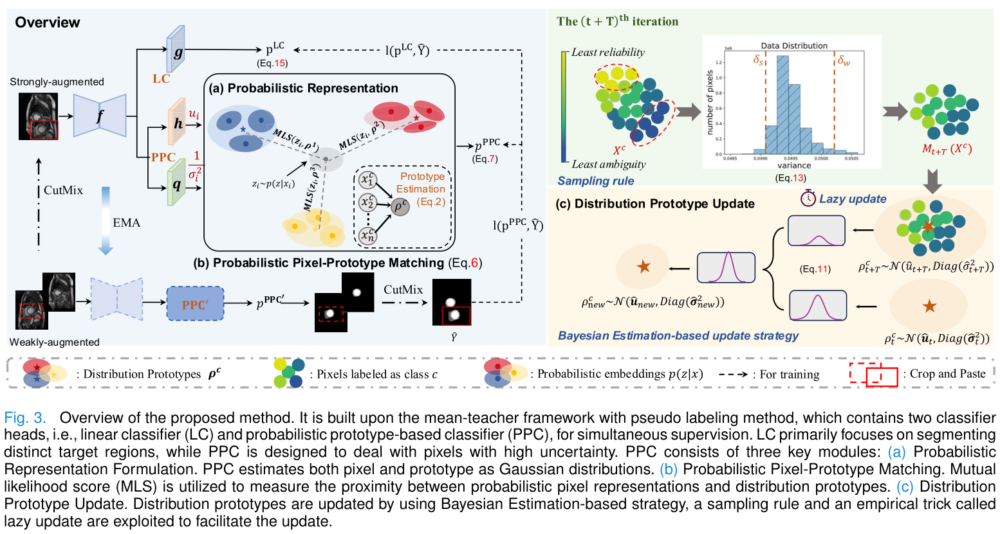
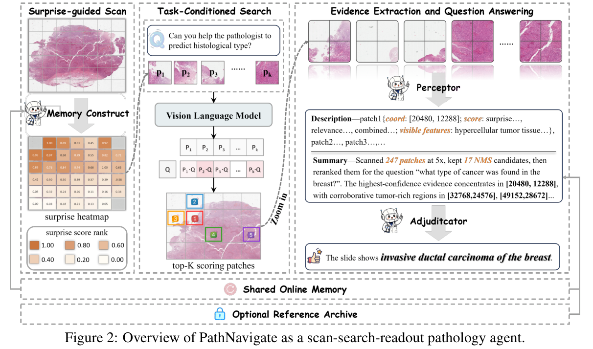
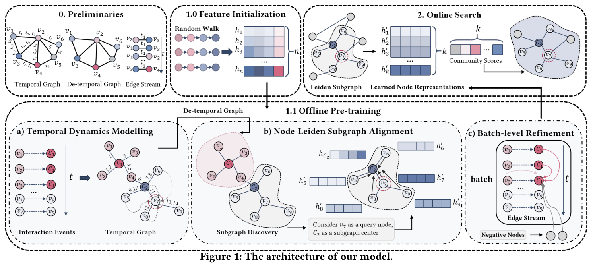
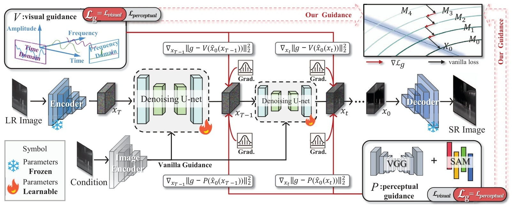
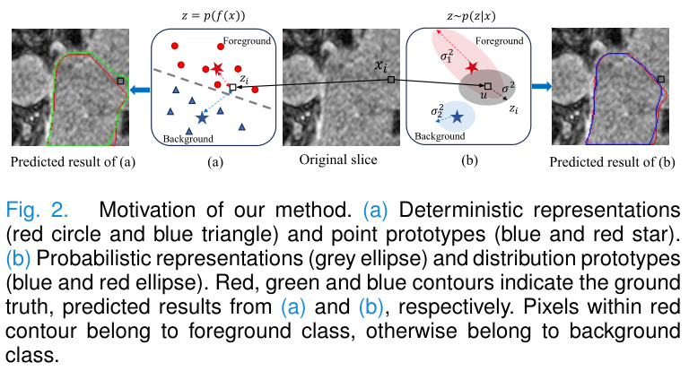
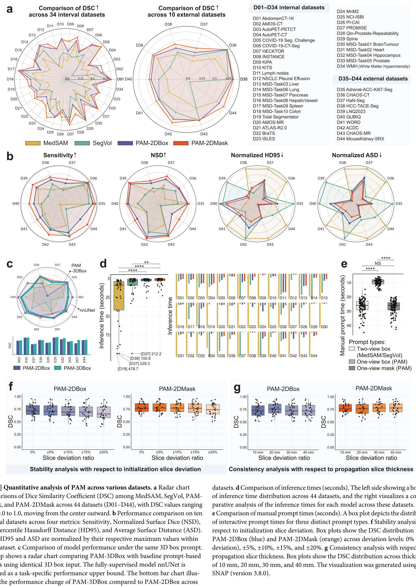

# Amazing Figures & Tables 🎨

论文图表收藏夹 —— 收集我认为好看的图和表。

## 目录结构

```
figures/
├── paradigm/     # 范式图
├── model/        # 模型图
├── motivation/   # 动机图
└── results/      # 结果图
tables/
├── comparison/   # 对比实验表
└── ablation/     # 消融实验表
```

---

## 🖼 图

### 范式图 (paradigm)

#### PathNavigate 范式对比图



- **论文**：*PathNavigate: A Training-Free Pathology Agent with Surprise-Guided Scan and Shared Slide Memory for Whole-Slide Image VQA*（arXiv 2026）
- **链接**：[arXiv:2605.23559](https://arxiv.org/abs/2605.23559)

### 模型图 (model)

#### WSI-Agents 总览图



- **论文**：*WSI-Agents: A Collaborative Multi-Agent System for Multi-Modal Whole Slide Image Analysis*（arXiv 2025）
- **链接**：[arXiv:2507.14680](https://arxiv.org/abs/2507.14680)

#### PathGen 多智能体协作流水线图



- **论文**：*PathGen-1.6M: 1.6 Million Pathology Image-text Pairs Generation through Multi-agent Collaboration*（ICLR 2025）
- **链接**：[arXiv:2407.00203](https://arxiv.org/abs/2407.00203)

#### DFQ+ 框架图



- **论文**：*Learning Generalized Medical Image Representation by Decoupled Feature Queries*（TPAMI 2025）
- **链接**：[IEEE 11122336](https://ieeexplore.ieee.org/document/11122336)

#### PRPL 方法总览图



- **论文**：*Effective Semi-Supervised Medical Image Segmentation With Probabilistic Representations and Prototype Learning*（TMI 2025）
- **链接**：[DOI 10.1109/TMI.2024.3484166](https://doi.org/10.1109/TMI.2024.3484166)

#### PathNavigate 总览图



- **论文**：*PathNavigate: A Training-Free Pathology Agent with Surprise-Guided Scan and Shared Slide Memory for Whole-Slide Image VQA*（arXiv 2026）
- **链接**：[arXiv:2605.23559](https://arxiv.org/abs/2605.23559)

#### UTCS 模型架构图



- **论文**：*UTCS: Effective Unsupervised Temporal Community Search with Pre-training of Temporal Dynamics and Subgraph Knowledge*（arXiv 2025）
- **链接**：[arXiv:2506.02784](https://arxiv.org/abs/2506.02784)

#### 扩散超分双引导框架图（来源未知）



### 动机图 (motivation)

#### PRPL 动机图



- **论文**：*Effective Semi-Supervised Medical Image Segmentation With Probabilistic Representations and Prototype Learning*（TMI 2025）
- **链接**：[DOI 10.1109/TMI.2024.3484166](https://doi.org/10.1109/TMI.2024.3484166)

### 结果图 (results)

#### PAM 定量分析图



- **论文**：*PAM: a propagation-based model for segmenting any 3D objects across multi-modal medical images*（npj Digital Medicine 2025）
- **链接**：[DOI 10.1038/s41746-025-02087-y](https://doi.org/10.1038/s41746-025-02087-y)

---

## 📊 表

### 对比实验表 (comparison)

*（暂无收藏）*

### 消融实验表 (ablation)

*（暂无收藏）*
